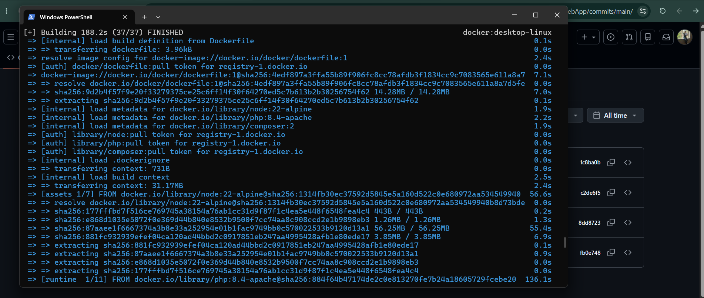
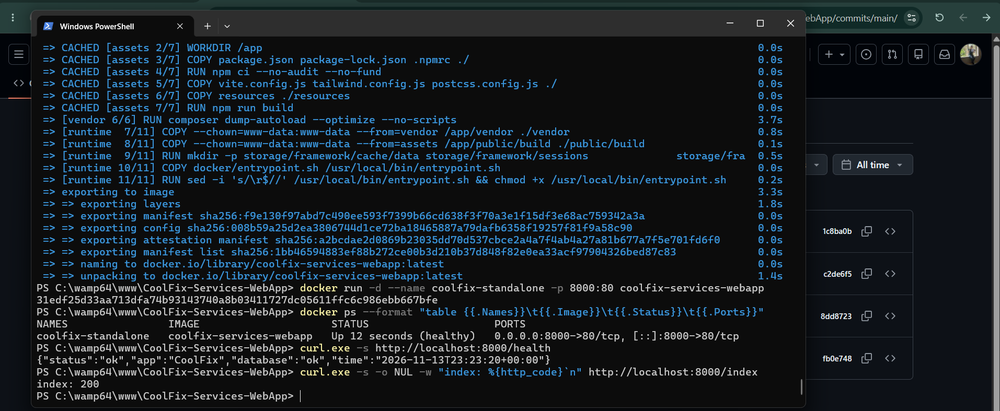
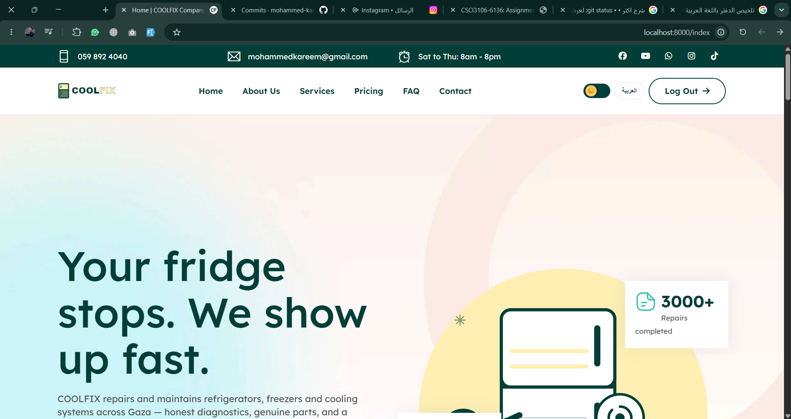
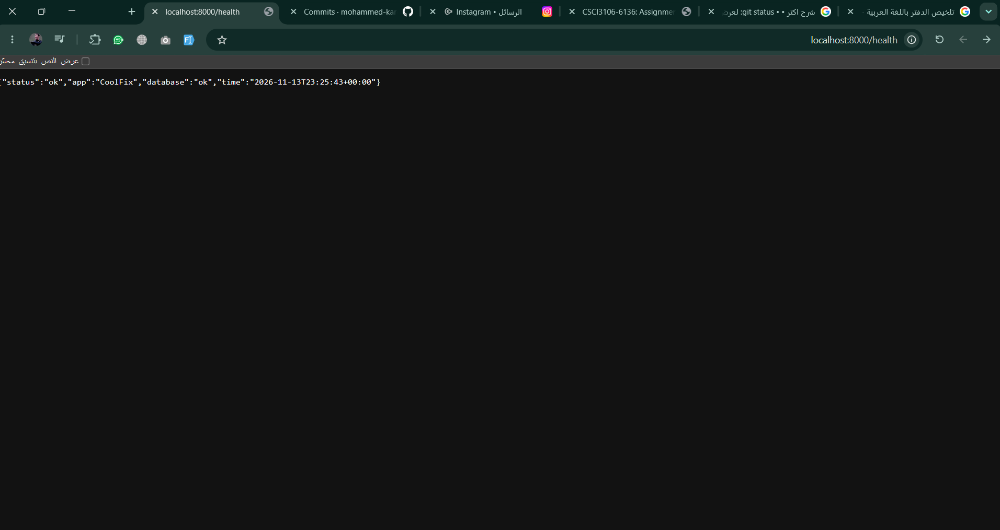

# CoolFix Services WebApp


**CoolFix** is a bilingual (English / Arabic) web platform for an air-conditioning and home-appliance
repair company. Visitors can browse services, pricing plans and FAQs, book a technician from the
FAQ page, and send contact requests. Registered users get a profile area, and administrators get a
dashboard to manage accounts (block / unblock, promote, mark top technicians, impersonate, delete).

The whole application is containerised, so any developer can run it with **one command** — no PHP,
Composer, Node.js or MySQL installation needed.

> ### 🔑 Demo access (no setup needed)
> On the first start the container **automatically seeds demo data**, including an admin account:
>
> | Role  | Email                | Password      |
> |-------|----------------------|---------------|
> | Admin | `admin@coolfix.test` | `password123` |
>
> You can also open the public pages directly (e.g. `/index`), click **"Continue as guest"** on the login page, or register a new account.

---

## Features

- Public pages: Home, About, Services, Pricing, FAQ, Contact
- Authentication (Laravel Breeze): register, login, password reset, **"Continue as guest"**
- Admin dashboard: list users, change role, block / unblock, mark as top technician, impersonate, delete
- Contact form and technician booking (stored in the database)
- File upload page
- AI-assisted FAQ search (Google Gemini, optional)
- English / Arabic language switcher, dark mode
- `/health` endpoint used by the Docker healthcheck and CI

## Tech Stack

| Layer          | Technology                                   |
|----------------|----------------------------------------------|
| Backend        | PHP 8.4, Laravel 13                          |
| Frontend       | Blade templates, Tailwind CSS, Alpine.js, Vite |
| Database       | MySQL 8.4 (Docker Compose) or SQLite (standalone container) |
| Web server     | Apache 2 (official `php:8.4-apache` image)   |
| DevOps         | Docker (multi-stage build), Docker Compose, GitHub Actions |

## Project Structure

```
CoolFix-Services-WebApp/
├─ app/                     # Laravel application code (controllers, models, middleware)
├─ resources/               # Blade views, CSS and JS sources
├─ routes/                  # Web routes (+ /health endpoint)
├─ database/                # Migrations, factories and seeders (demo data)
├─ public/                  # Web root (images, theme assets)
├─ docker/
│  ├─ entrypoint.sh         # Startup script: APP_KEY, wait for DB, migrate, seed
│  └─ php.ini               # PHP runtime settings
├─ docs/
│  ├─ screenshots/          # Assignment screenshots
│  └─ notes.md              # Technical notes
├─ scripts/run.ps1          # Windows helper (same commands as the Makefile)
├─ .github/workflows/       # CI: build the image and smoke-test it
├─ Dockerfile               # Multi-stage build (Node → Composer → PHP/Apache)
├─ docker-compose.yml       # App + MySQL
├─ Makefile                 # make build / run / stop / up / down ...
├─ .dockerignore
├─ .gitignore
└─ LICENSE
```

---

## Prerequisites

- [Docker Desktop](https://www.docker.com/products/docker-desktop/) (includes Docker Compose)
- Git

That's all — PHP, Composer, Node.js and MySQL all run inside the containers.

## Quick Start (recommended): Docker Compose

Runs the Laravel app **and** a MySQL database together.

```bash
git clone https://github.com/mohammed-kaream/CoolFix-Services-WebApp.git
cd CoolFix-Services-WebApp
docker compose up -d --build
```

Open **http://localhost:8000** (the first start takes ~30 seconds while MySQL initialises and demo data is seeded).

Check the status:

```bash
docker compose ps          # both services should be "running" / "healthy"
docker compose logs -f app # follow application logs
```

## Alternative: Plain Docker (single container)

The image also runs on its own, using an SQLite database inside the container.

```bash
# 1. Build the image
docker build -t coolfix-services-webapp .

# 2. Run the container
docker run -d --name coolfix-standalone -p 8000:80 coolfix-services-webapp

# 3. Check it is running (STATUS should become "healthy")
docker ps
```

Open **http://localhost:8000**.

## Stopping and Cleaning Up

```bash
# Docker Compose
docker compose down           # stop and remove containers (data is kept)
docker compose down -v        # also delete the database volume (full reset)

# Plain Docker
docker stop coolfix-standalone
docker rm coolfix-standalone
docker rmi coolfix-services-webapp   # remove the image
```

## Shortcuts (Makefile / PowerShell)

| Make (Linux / macOS / Git Bash) | Windows PowerShell              | What it does                         |
|---------------------------------|---------------------------------|--------------------------------------|
| `make build`                    | `.\scripts\run.ps1 build`       | Build the image                      |
| `make run`                      | `.\scripts\run.ps1 run`         | Run standalone container (SQLite)    |
| `make stop`                     | `.\scripts\run.ps1 stop`        | Stop + remove standalone container   |
| `make up`                       | `.\scripts\run.ps1 up`          | Start app + MySQL (Compose)          |
| `make down`                     | `.\scripts\run.ps1 down`        | Stop Compose stack                   |
| `make logs`                     | `.\scripts\run.ps1 logs`        | Follow app logs                      |
| `make fresh`                    | `.\scripts\run.ps1 fresh`       | Reset DB and reload demo data        |
| `make clean`                    | `.\scripts\run.ps1 clean`       | Remove containers, volumes and image |

---

## Configuration

| Setting            | Default                         | Notes |
|--------------------|---------------------------------|-------|
| Host port          | `8000`                          | Change with `APP_PORT=9000 docker compose up -d` |
| Container port     | `80`                            | Apache inside the container |
| `DB_CONNECTION`    | `mysql` (Compose) / `sqlite` (standalone) | |
| `DB_HOST` / `DB_DATABASE` | `db` / `coolfix`         | Defined in `docker-compose.yml` |
| `DB_USERNAME` / `DB_PASSWORD` | `coolfix` / `coolfix_secret` | Demo credentials — change for production |
| `APP_KEY`          | auto-generated on first start   | Stored in the `app_storage` volume |
| `SEED_DATABASE`    | `true`                          | Seeds demo data only when the database is empty |
| `MAIL_MAILER`      | `log`                           | E-mails are written to the log instead of being sent |
| `GEMINI_API_KEY`   | *(empty)*                       | Optional — enables AI FAQ search: `GEMINI_API_KEY=xxx docker compose up -d` |

No `.env` file is needed to run with Docker — all values are passed as environment variables.
`.env.example` is provided for running the project without Docker.

## How to Test

1. **Health check** — open http://localhost:8000/health. Expected:
   ```json
   {"status":"ok","app":"CoolFix","database":"ok","time":"..."}
   ```
2. **Public pages** — http://localhost:8000/index, `/about`, `/services`, `/pricing`, `/faq`, `/contact`
3. **Guest access** — open http://localhost:8000, click **"Continue as guest"** on the login page.
4. **Admin dashboard** — log in with the seeded demo admin:
   - Email: `admin@coolfix.test`
   - Password: `password123`

   then open http://localhost:8000/posts/inform to manage users (block, promote, delete...).
5. **Register** a new account at http://localhost:8000/register and edit it from the profile page.
6. **Contact form** — submit a message on `/contact`; it is saved and shown on the confirmation page.

## Continuous Integration

Every push and pull request to `main` runs [`.github/workflows/docker-build.yml`](.github/workflows/docker-build.yml), which:

1. builds the Docker image (with layer caching),
2. starts a container and waits until Docker reports it **healthy**,
3. smoke-tests `/health` and `/login`.

## Screenshots

| Docker build | Container running |
|---|---|
|  |  |

| Application | Health endpoint |
|---|---|
|  |  |

More screenshots (commit history, pull request, CI run) are in [`docs/screenshots/`](docs/screenshots/).

## Technical Notes

See [`docs/notes.md`](docs/notes.md) for the main Docker problem faced during this work and the key Git/GitHub lessons learned.

## Author & Attribution

Developed by **Mohammed Kareem Kohail** ([@mohammed-kaream](https://github.com/mohammed-kaream)) as an original project
and containerised for *OS Lab – Assignment #2 (Docker & GitHub)*.
Built on the open-source [Laravel](https://laravel.com) framework (MIT) with Laravel Breeze for authentication.

## License

Released under the [MIT License](LICENSE).
